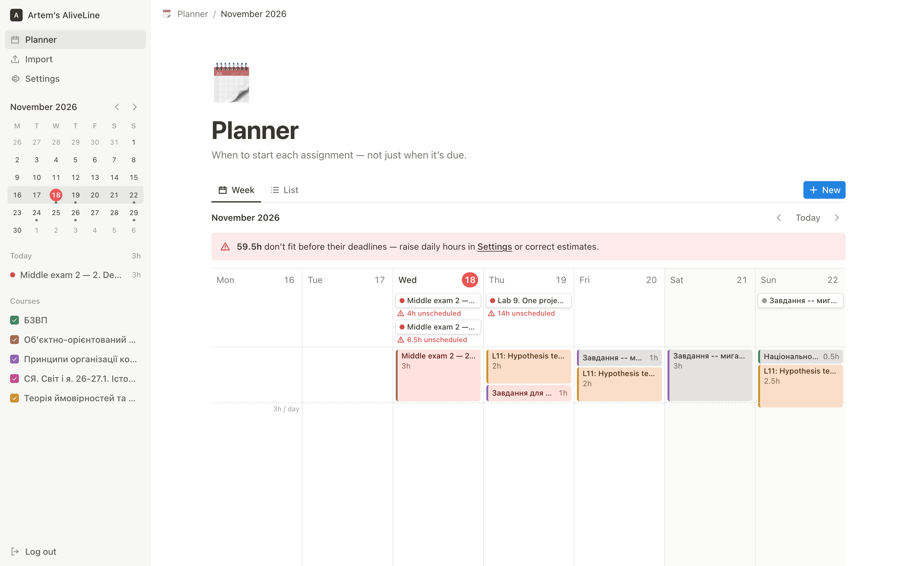

# AliveLine

[](https://github.com/mr-amigo/AliveLine/actions/workflows/ci.yml)

**An AI planner for UCU students that tells you *when to start*, not just when it's due.**
AliveLine collects your deadlines, estimates how many hours each assignment needs, and gives every task a work window: a start date and a personal target finish date.

> Live: **https://d2b7fp4wgl1dok.cloudfront.net**



## Why
Moodle, Google Calendar and Todoist remind you about the **submission date**. That's the wrong signal: a deadline says nothing about how long the work takes, so work slides to the last night. AliveLine counts back from the real deadlines across *all* your assignments and your daily capacity, and shows the day you need to start.

## Features (v1)
- Sign up / sign in (httpOnly cookie session)
- Add assignments manually or import a Moodle calendar (`.ics`)
- AI estimate of hours from the assignment description (OpenAI, heuristic fallback), editable by the student
- Work window per assignment + status: **can wait**, **time to start**, **critical**, **done**
- Week calendar (work blocks sized by hours, deadlines row, daily capacity line) and grouped list view; overload warning when hours don't fit
- Personal settings: daily capacity (hours/day) and buffer days before deadlines
- Early-access waitlist on the landing page

## Architecture
One origin for the site and the API, so the httpOnly session cookie works without CORS.

```
Browser ──HTTPS──▶ CloudFront ──/*─────────▶ S3 (React SPA: Vite, TS, Tailwind)
                             ├──/api/ai/*──▶ AI Lambda (outside VPC) ─▶ OpenAI gpt-4.1-mini (heuristic fallback)
                             └──/api/*─────▶ Lambda function URL: FastAPI (Mangum) ─▶ Aurora Serverless v2 PostgreSQL (private VPC)

FastAPI: routers ─▶ services ─▶ domain (pure: planner, estimators, importers) + SQLAlchemy models
```
- **Work windows are computed on read** by `WorkWindowPlanner`: earliest deadline first, each task placed as late as possible within your daily capacity minus buffer days, so near deadlines get today and far ones wait. Hours that don't fit show up as "unscheduled".
- **Estimation is a Strategy** (`OpenAIEstimator` → `HeuristicEstimator`); **imports are Adapters** (`IcsSource`, `MoodleApiSource` stub) behind `AssignmentSource`.
- The AI Lambda sits outside the VPC so it can reach OpenAI without a NAT gateway ($0 idle); the browser calls it, then sends the estimate with the assignment.
- Same image for both Lambdas, tagged with the git commit. CI (GitHub Actions) runs `pytest` and the SPA build on every push.
Locally (and in `infra/Dockerfile`), FastAPI serves the built SPA itself, with SQLite or Postgres.

Full OOAD design (use cases, domain model, planning algorithm, API, phases): [docs/PLAN.md](docs/PLAN.md).
Product one-pager: [docs/ONE_PAGER.md](docs/ONE_PAGER.md).

## Repo layout
```
backend/    FastAPI app (app/core, models, schemas, domain, services, api) + pytest tests
frontend/   React 18 + TypeScript + Vite + Tailwind v4
infra/      CloudFormation (backend-ecr, backend, ai, frontend), Dockerfile.lambda, Dockerfile (all-in-one), docker-compose.yml
Makefile    make aws-* deployment targets (`make` lists them)
docs/       PLAN.md (design), DESIGN.md (UI system), ONE_PAGER.md
.github/    CI workflow (pytest + npm run build)
```

## Run locally
Requirements: Python 3.12, Node 22.

```bash
# backend → http://localhost:8000 (API docs at /api/docs)
cd backend
python -m venv .venv && source .venv/bin/activate
pip install -r requirements.txt
cp .env.example .env          # optional; defaults work (SQLite)
uvicorn app.main:app --reload

# frontend → http://localhost:5173 (proxies /api to :8000)
cd frontend
npm install
npm run dev

# tests
cd backend && pytest -q
```

## Run with Docker
```bash
# single container, SQLite inside the container
docker build -f infra/Dockerfile -t aliveline .
docker run -p 8000:8000 -e SECRET_KEY=dev aliveline        # http://localhost:8000

# prod-like: app + Postgres 16
docker compose -f infra/docker-compose.yml up --build
```

## Deploy (AWS)
Everything is CloudFormation in `infra/`, driven by the `Makefile`; region `us-east-1`.
Needs: AWS CLI v2, Docker with buildx, Node 22.

1. `cp .env.example .env` and fill in `AWS_ACCESS_KEY_ID`, `AWS_SECRET_ACCESS_KEY`, `BUDGET_EMAIL` (a $5/month budget alert) and `OPENAI_API_KEY` (AI estimates; optional).
2. `make aws-deploy`. It creates the ECR repo, pushes the Lambda image (tagged with the commit), deploys VPC + Aurora + Lambda (the first run takes about 10 minutes), creates tables, deploys S3 + CloudFront, then uploads the SPA.
3. `make aws-url` prints the site URL (`https://<id>.cloudfront.net`). Open it and sign up.

After code changes: `make aws-push aws-backend aws-ai` (backend) or `make aws-publish` (frontend). Useful: `make aws-health`, `make aws-logs`, `make aws-ai-logs`, `make aws-destroy`.

Ops (Aurora is private, so these invoke the backend Lambda directly):
- `make aws-stats` → `{"waitlist", "users", "returning_users", "assignments"}`; a returning user signed in on at least 2 distinct days (Kyiv time).
- `make aws-delete-user EMAIL=...` removes an account and all its data.

### Cost
| Item | Idle | Notes |
|---|---|---|
| CloudFront + S3 | $0 | flat-rate Free plan, WAF rate limit included |
| 2 Lambdas | $0 | free tier covers this scale |
| Aurora Serverless v2 | ~$0.10/GB-month storage | min 0 ACU, pauses after 5 idle min; ~$0.12/ACU-hour while awake |
| Secrets Manager | $0.80 | 2 secrets |
| OpenAI gpt-4.1-mini | ~$0.001 per estimate | only when a student asks for an estimate |

About **$1/month** idle, with a $5/month AWS Budget alert. The first request after a pause takes about 15 s while Aurora resumes (the UI shows "waking up"). If the account can't use the CloudFront Free plan (e.g. AWS Free Tier accounts), deploy with `make aws-deploy CLOUDFRONT_PLAN=PAY_AS_YOU_GO`.

## Environment variables
| Variable | Default | Description |
|---|---|---|
| `ENV` | `dev` | `prod` refuses to start with the default `SECRET_KEY` |
| `SECRET_KEY` | dev placeholder | JWT signing key. **Required in prod**; on AWS, generated in Secrets Manager |
| `DATABASE_URL` | `sqlite:///./aliveline.db` | SQLAlchemy URL; `postgres://` URLs accepted as-is. On AWS, built from the Aurora secret |
| `DB_NULL_POOL` | `false` | `true` on Lambda: no pooled connections, so Aurora can pause |
| `COOKIE_SECURE` | `false` | `true` behind HTTPS (set on AWS) |
| `APP_TZ` | `Europe/Kyiv` | Time zone for day-based planning |
| `OPENAI_API_KEY` | empty | Enables AI estimates via OpenAI (AI Lambda; root `.env` for `make aws-ai`) |
| `VITE_GOATCOUNTER` | empty | GoatCounter site code for cookieless page counts (root `.env`, baked in by `make aws-publish`) |
| `OPENAI_MODEL` | `gpt-4.1-mini` | OpenAI model for estimates |
| `PORT` | `8000` | Port of the all-in-one container |

## Team
Artem Serhiichuk · Ostap Sukhomlyn · Andrii Antoniuk. OOAD course, Ukrainian Catholic University.
