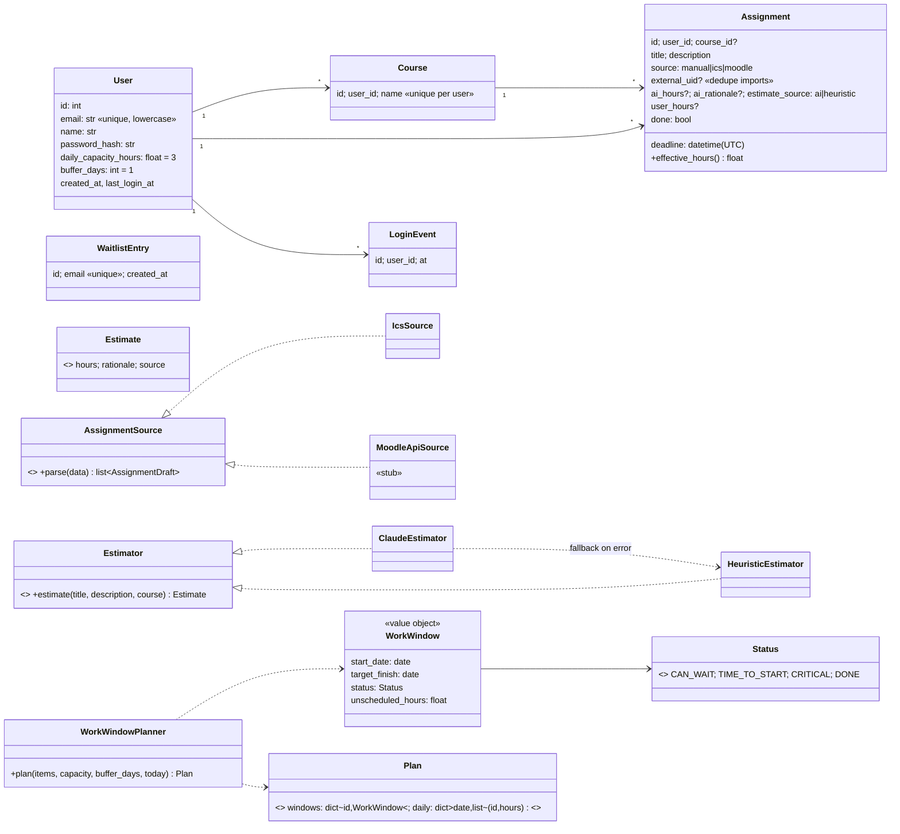

# AliveLine — OOAD plan

Team: Artem Serhiichuk, Ostap Sukhomlyn, Andrii Antoniuk.
Grading targets (must be hit first): **(A)** repo has `backend/`, `frontend/`, `infra/`, `README.md` explaining product + run + deploy (3 pts);
**(B)** deployed over HTTPS, users can sign up and sign in (3 pts). Phases 1–3 secure both; later phases add the product value.

---

## 1. Problem & vision
Students see a deadline but not how long the work takes → they start the night before.
Moodle / Google Calendar / Todoist show the **due date**. AliveLine shows the **start date**:
AI estimates hours from the assignment description, then a planner counts back from all deadlines
using the student's daily capacity and tells them which tasks need attention today.

Success metrics (from one-pager): 20 early-access signups in 7 days; 8 returning students
(second login on a different day); donations ≥ 20 UAH after testing.
→ The product therefore needs: a public landing page with an early-access form, and a `last_login_at`/login log to count returns.

## 2. Actors & use cases
| Actor | Use case |
|---|---|
| Visitor | UC1 Join early-access list (email) · UC2 Sign up |
| Student | UC3 Sign in / sign out · UC4 Add assignment manually · UC5 Import Moodle calendar (.ics) · UC6 Get AI estimate and correct it · UC7 View plan (work windows, statuses, "today" list) · UC8 Edit / delete / mark done · UC9 Set daily capacity & buffer |
| AI service (Claude on Amazon Bedrock) | Secondary actor in UC4/UC5/UC6 |
| Moodle API | Future secondary actor (UC5b, stub only in v1) |

Out of scope v1: notifications, mobile app, Moodle API sync (interface only), teams/sharing.

**Main scenario UC7 (core value):** student opens dashboard → system loads open assignments → for each takes effective hours
(user correction or AI) → planner allocates hours backward from each target finish across all assignments within daily capacity →
returns per-assignment window + status + today's allocation → UI groups cards by status, shows "Today: 2h Lab 3, 1h Essay".

## 3. Domain model

Design decisions:
- **Strategy** — `Estimator` (Claude vs heuristic); `get_estimator()` **factory** picks Claude when `BEDROCK_MODEL` is set (AI Lambda, local dev with AWS creds), else heuristic (main backend Lambda: in a VPC without internet). Claude errors/timeouts fall back to heuristic, so the app never breaks.
- **Adapter** — `AssignmentSource` turns external formats (.ics now, Moodle API later) into `AssignmentDraft` dataclasses.
- **Value objects** — `WorkWindow`, `Estimate`, `Plan` are frozen dataclasses; computed on read → no stale data.
- **Service layer + DTOs** — routers thin, services own transactions, Pydantic schemas at the boundary.
- **Dependency injection** — FastAPI `Depends(get_db)`, `Depends(current_user)`, `Depends(get_estimator)` (overridable in tests).
- No repository layer (YAGNI: SQLAlchemy session is already a unit-of-work); services query directly.
- No Alembic in v1: `create_all()` on local startup and via `make aws-migrate` on AWS. It only adds **new tables**, so a column change on an existing table after real users exist needs Alembic (or a one-off SQL in a Lambda action).

## 4. Planning algorithm (domain/planner.py)

Input: `items: list[PlanItem(id, deadline: date, hours: float, done: bool)]`, `capacity` h/day, `buffer_days`, `today`.

1. Open items only (`done=False`); done → status `DONE`, no window.
2. `target_finish = max(today, deadline - buffer_days)`; if `deadline < today` → target_finish = deadline (overdue).
3. Sort open items by `target_finish` **descending** (latest first) — backward "as-late-as-possible" scheduling (mirror of EDF, optimal for feasibility).
4. `free[day] = capacity` for every day in `[today, max target_finish]`.
5. For each item: walk days from `target_finish` back to `today`, take `min(free[day], remaining)`, record allocation. Leftover → `unscheduled_hours`.
6. `start_date` = earliest allocated day (or `today` if none/overdue).
7. Status:
   - `CRITICAL` if `unscheduled_hours > 0` (can't fit before deadline) or deadline already passed or `(deadline - today).days <= 1`.
   - `TIME_TO_START` if `start_date <= today + 1 day` (start today or tomorrow).
   - `CAN_WAIT` otherwise.
8. Return `Plan(windows, daily)`; `daily[today]` powers the "Today" panel, `daily` sliced to the requested range powers the week grid (DESIGN.md §5).

Rounding: hours to 0.5. Capacity validated 0.5–12, buffer 0–7.
Required tests (tests/test_planner.py): single item fits; two overlapping items push the earlier one earlier; insufficient capacity → critical with unscheduled hours; overdue → critical; done → DONE; far deadline → can_wait; boundary for time_to_start.

## 5. Estimation (domain/estimation/)
- `base.py`: `Estimate` dataclass (hours, rationale, source), `Estimator` Protocol.
- `heuristic.py`: keyword base hours (project 10, exam/test prep 6, essay 5, report/lab 4, homework/problem set 3, quiz 1, default 3) + `min(len(words)/150, 4)`; clamp 0.5–40; rationale explains the rule.
- `claude.py`: `anthropic.AnthropicBedrock` (IAM role creds, region us-east-1), model `BEDROCK_MODEL=us.anthropic.claude-haiku-5-5`, timeout 15 s, small max_tokens; prompt: "Estimate focused hours a 1st–2nd year university student needs… return JSON {hours, rationale (≤ 1 sentence)}". Parse + clamp; any exception → heuristic. (Load `claude-api` skill before writing.) Input capped (title 200, description 4000 chars).
- **Where it runs** (backend Lambda has no internet → no Bedrock):
  - `api/ai.py`: `POST /api/ai/estimate {title, description?, course_name?}` → `Estimate`. Auth = verify our JWT cookie only (no DB). Served by a separate **AI Lambda** outside the VPC (`app/ai_handler.py`: tiny FastAPI app with this router + Mangum; same ECR image, command override); CloudFront routes `/api/ai/*` there. Locally the router is also mounted in `main.py`.
  - Backend: `POST /assignments` / `PATCH` accept optional `estimate {hours, rationale, source}` from the client; if absent and no `user_hours` → heuristic on the server. Student's own data, so trusting the client estimate is fine.
  - Frontend (phase 7): form calls `/api/ai/estimate` on "Estimate"/create and sends the result; after .ics import it estimates new items sequentially (cap 30) and PATCHes them.
- Cost: Bedrock tokens only (Haiku, ~1k tokens per estimate); WAF rate limit + $5 budget guard it.

## 6. Import (domain/importers/)
- `ics.py` using `icalendar`: for each `VEVENT` → `AssignmentDraft(title, description, deadline=DTEND or DTSTART, course=CATEGORIES or None, external_uid=UID)`.
  Clean Moodle titles: strip suffixes `" is due"`, `" closes"`, `" should be completed"`.
  Skip events whose deadline is > 30 days in the past.
- Service upserts by `(user_id, external_uid)`: new → create (heuristic estimate); existing → update deadline/description only (keep user_hours, done, estimates).
- Response: `{created, updated, skipped, created_ids}` (`created_ids` lets the frontend run AI estimates on new items).
- `moodle.py`: `MoodleApiSource` raising `NotImplementedError` + docstring on how to plug a token later.
- Test (tests/test_ics.py) with a small inline Moodle-style .ics fixture.

## 7. REST API (all under `/api`)
| Method | Path | Auth | Body → Response |
|---|---|---|---|
| GET | /health | – | `{status:"ok"}` |
| POST | /waitlist | – | `{email}` → 201 (idempotent) |
| POST | /auth/signup | – | `{email, password(≥8), name}` → `UserOut` + cookie |
| POST | /auth/signin | – | `{email, password}` → `UserOut` + cookie (logs LoginEvent) |
| POST | /auth/signout | ✓ | → 204, clears cookie |
| GET | /auth/me | ✓ | → `UserOut` (401 if no/invalid cookie) |
| PATCH | /settings | ✓ | `{name?, daily_capacity_hours?, buffer_days?}` → `UserOut` |
| GET | /plan?from=YYYY-MM-DD&days=7 | ✓ | → `{today, capacity, today_items:[DayItem], days:[{date, items:[DayItem]}], assignments:[AssignmentOut]}`; `DayItem={assignment_id,title,course_name,hours,status}`; defaults: from = Monday of current week, days 7 (max 31) |
| POST | /assignments | ✓ | `{title, description?, course_name?, deadline, user_hours?, estimate?}` → `AssignmentOut` |
| PATCH | /assignments/{id} | ✓ | partial (incl. `user_hours`, `done`, `estimate`) → `AssignmentOut` |
| DELETE | /assignments/{id} | ✓ | → 204 |
| POST | /ai/estimate | ✓ (JWT only) | `{title, description?, course_name?}` → `{hours, rationale, source}` (AI Lambda) |
| POST | /import/ics | ✓ | multipart `file` (≤ 1 MB) → `{created, updated, skipped, created_ids}` |

`AssignmentOut = {id, title, description, course_name, deadline, source, ai_hours, ai_rationale, estimate_source, user_hours, effective_hours, done, window:{start_date, target_finish, status, unscheduled_hours} | null}`.
Every mutation endpoint returns windows recomputed for the whole plan (simplest: frontend refetches `/plan` after mutations).
Ownership: every assignment query filters by `user_id`; foreign id → 404. **Never 403** (CloudFront maps 403 → SPA).

Security: bcrypt (cost 12); JWT HS256, 7-day exp, claim `sub=user_id`; cookie httpOnly, SameSite=Lax, `Secure` when `COOKIE_SECURE=true`; generic "Invalid email or password"; email normalized lowercase; `SECRET_KEY` required when `ENV=prod`.

## 8. Frontend
**Visual design, layout, components, tokens: [docs/DESIGN.md](DESIGN.md)** (Notion-Calendar-style, own brand). This section is only routes + code structure.

Routes:
| Path | Page | Notes |
|---|---|---|
| `/` | Landing | hero + static WeekGrid preview with demo data, 3 steps, early-access form, CTA. Redirect to /app if signed in |
| `/signup`, `/signin` | Auth | centered column, inline validation, show API `detail` |
| `/app` | Planner | App shell (Sidebar: MiniMonth, Today list, Courses; TopBar; Week/List view). `?week=YYYY-MM-DD`, `?view=list`. Drawer for assignment details (`?a=:id`, `?a=new`) |
| `/app/import` | Import | in shell; dropzone, Moodle export steps, result + AI pass over `created_ids` |
| `/app/settings` | Settings | in shell; name, daily capacity, buffer days |

Structure: `api/client.ts` (fetch wrapper, `credentials:'include'`, throws `ApiError(detail)`), `api/types.ts` (mirrors §7),
`auth/AuthContext.tsx`, `auth/RequireAuth.tsx`,
`components/shell/` (AppShell, Sidebar, MiniMonth, TopBar), `components/plan/` (WeekGrid, DayColumn, WorkBlock, DeadlineChip, ListView, TodayList, StatusDot),
`components/assignment/` (AssignmentDrawer, EstimatePanel, HoursStepper), `components/ui/` (Button, Input, Field, Kbd, Toast, Spinner, Skeleton),
`hooks/` (usePlan(week), useShortcuts), `lib/dates.ts` (week math in Europe/Kyiv, `Intl.DateTimeFormat('en-GB')`, relative "in 3 days"), `pages/` one file per route.
State: URL params (week, view, open drawer) + refetch `/plan` after each mutation (no state lib).

## 9. Infra & deployment
AWS, CloudFormation + Makefile (pattern from the course's reference project), region `us-east-1`.
- **Site + API on one origin**: CloudFront (`*.cloudfront.net`, HTTPS, flat-rate Free plan + WAF rate limit). Default behavior → private S3 bucket (SPA, OAC). `/api/*` → Lambda function URL (CachingDisabled, AllViewerExceptHostHeader so the cookie passes). SPA fallback maps only **403** → `/index.html`, so the API must never return 403.
- **Backend**: `infra/Dockerfile.lambda` (`public.ecr.aws/lambda/python:3.12`, arm64), `app/lambda_handler.py` (Mangum, lifespan off; `{"action":"migrate"}` → `create_all`). Image in ECR (`infra/backend-ecr.yaml`), tagged with the commit SHA.
- **DB**: Aurora Serverless v2 PostgreSQL 16, min 0 ACU (auto-pause 5 min), private subnets, no NAT. `DB_NULL_POOL=true` so it can pause. `DATABASE_URL` and `SECRET_KEY` are resolved from Secrets Manager at deploy (`infra/backend.yaml`).
- **Cost guard**: `AWS::Budgets::Budget` of $5/month → `BUDGET_EMAIL`.
- **Make**: `make aws-deploy` (ecr → push → backend → migrate → frontend → publish); `aws-push aws-backend` / `aws-publish` for updates; root `.env` (git-ignored) holds AWS keys.
- **AI Lambda** (phase 5, `infra/ai.yaml`): outside the VPC, same image with `ImageConfig.Command=app.ai_handler.handler`, IAM `bedrock:InvokeModel` on the Haiku inference profile, function URL; frontend stack gets optional `AiDomain` → behavior `/api/ai/*` (listed before `/api/*`).
- **Ops via Lambda actions** (Aurora is private): `{"action":"migrate"}` → `make aws-migrate`; `{"action":"stats"}` → `make aws-stats` (phase 8).
- **Account**: shared AWS account (keys from the reference project, root `.env`). Never touch `onetwothree`/`meetings-*` stacks; everything ours is `aliveline-*`. CloudFront Free plan: 3 per account, 1 used by onetwothree.
- **Local**: `infra/Dockerfile` (node:22-slim build → python:3.12-slim, FastAPI serves `static/`) and `infra/docker-compose.yml` (app + postgres:16) stay for local runs.
- CI (optional, phase 8): GitHub Action running `pytest` + `npm run build`.

## 10. README outline (phase 3, refined in 8)
What it is (2 lines + screenshot) · Why (problem vs Moodle/Calendar) · Features · Architecture (diagram link to this file) · Repo layout · Run locally · Run with Docker · Deploy (AWS) · Env vars table · Team.

---

## Phases
Each phase ≈ one session. Tick boxes as you go. Keep scope tight.

### Phase 1 — Backend core + auth  (secures B, part 1)
- [x] `backend/requirements.txt`, `.env.example`, `app/core/{config,db,security,deps}.py`
- [x] models: User, LoginEvent, WaitlistEntry (Course/Assignment added in phase 4)
- [x] schemas/auth.py; services/auth_service.py; api/{health,auth,settings,waitlist}.py; main.py (create_all, routers, SPA fallback)
- [x] tests/conftest.py (SQLite in-memory, TestClient) + tests/test_auth.py (signup, duplicate, signin bad/good, me, signout)
- [x] check root .gitignore covers `.venv`, `node_modules`, `dist`, `*.db`, `.env`
- DoD: `pytest -q` green; manual curl signup/me works.

### Phase 2 — Frontend shell + auth pages  (secures B, part 2)
- [x] Vite React TS scaffold (write files directly, don't run interactive create), Tailwind v4, router, proxy
- [x] api/client.ts, api/types.ts, AuthContext, RequireAuth, Layout/Navbar, basic UI primitives
- [x] pages: Landing (simple version + waitlist form), SignUp, SignIn, Dashboard placeholder, Settings
- DoD: `npm run build` ok; locally sign up → land on /app → refresh keeps session → sign out.

### Phase 3 — Infra + deploy + README  (secures A & B)
- [x] infra/Dockerfile, infra/docker-compose.yml (local); `docker build` + run → sign up works on :8000
- [x] README.md per §10 (first version)
- [x] AWS infra: infra/{backend-ecr,backend,frontend}.yaml, Dockerfile.lambda, lambda_handler.py, Makefile
- [x] root `.env`: AWS keys (from reference project) + `BUDGET_EMAIL=mr.amigo98797@gmail.com`; `make aws-deploy`
- [x] verify on CloudFront URL: health, sign up, refresh keeps session, sign out, sign in; put URL in README; push
- DoD: live HTTPS URL, sign up/in works.

### Phase 4 — Assignments + planner (core domain)
- [ ] models Course, Assignment (incl. ai_hours, ai_rationale, estimate_source); domain/planner.py; tests/test_planner.py (cases in §4)
- [ ] domain/estimation/{base,heuristic}.py (server default estimate); services/assignment_service.py, services/plan_service.py; api/assignments.py (accepts optional `estimate`), GET /plan with `from`/`days` range (§7)
- [ ] tests/test_assignments.py (CRUD, ownership 404, client estimate vs heuristic, plan statuses)
- [ ] `make aws-push aws-backend aws-migrate`; smoke `/api/plan` on live
- DoD: tests green; live API creates tables + returns plan.

### Phase 5 — AI estimation (Claude on Bedrock)
- [ ] load `claude-api` skill; domain/estimation/claude.py (AnthropicBedrock) + `get_estimator()` factory
- [ ] api/ai.py (`POST /ai/estimate`, JWT-only auth), app/ai_handler.py; mount router in main.py for local
- [ ] infra/ai.yaml + Makefile `aws-ai`; frontend.yaml `AiDomain` + `/api/ai/*` behavior
- [ ] tests: heuristic, fake Claude client (JSON parse/clamp/fallback), /ai/estimate auth 401
- DoD: live `/api/ai/estimate` returns Claude estimate + rationale; on error → heuristic.

### Phase 6 — .ics import
- [ ] domain/importers/{base,ics,moodle}.py; services/import_service.py; api/imports.py (returns `created_ids`)
- [ ] tests/test_ics.py (parse, title cleanup, skip old, upsert keeps user fields)
- DoD: real Moodle export imports on live.

### Phase 7 — Product UI (docs/DESIGN.md)
- [ ] load `frontend-design` skill once; tokens from DESIGN.md §2–4 into `index.css` `@theme`; Inter; ui primitives restyled (Button, Input, Kbd, Toast, Skeleton)
- [ ] App shell: Sidebar (MiniMonth, TodayList, Courses), TopBar (Today, ‹ ›, title, Week|List, + New); routes per §8
- [ ] WeekGrid (deadline row, height ∝ hours, capacity line, today column) + ListView (status sections); usePlan(week)
- [ ] AssignmentDrawer: create/edit, EstimatePanel (calls /ai/estimate, rationale, HoursStepper), mark done, delete
- [ ] Import page (dropzone, steps, AI pass over `created_ids`), Settings + Auth restyle, Landing with WeekGrid preview
- [ ] keyboard shortcuts (DESIGN §7), responsive (§5: list + 3-day + bottom sheet on mobile), empty/loading/"waking up"/error states
- [ ] `make aws-publish`
- DoD: on live site: sign up → import .ics → week grid shows blocks/deadlines → correct hours in drawer → statuses update; works at 375px.

### Phase 8 — Finish
- [ ] Lambda action `stats` + `make aws-stats` (waitlist count, users, returning users = LoginEvents on ≥ 2 distinct days)
- [ ] README final (screenshot, live URL, architecture, cost), GitHub Action CI (pytest + npm run build)
- [ ] final `make aws-deploy` + smoke test

## Progress log
- 2026-11-18 — Phase 0: plan written (CLAUDE.md, docs/PLAN.md, docs/ONE_PAGER.md).
- 2026-11-18 — Phase 1 done: FastAPI core, cookie-JWT auth, settings, waitlist, LoginEvent; 8 tests green. Added `schemas/common.UtcDatetime` (SQLite drops tz) — use it for all datetime outputs.
- 2026-11-18 — Phase 2 done: Vite/React/TS/Tailwind v4 shell; AuthContext, RequireAuth, Landing (+waitlist, preview card), SignIn/SignUp (shared AuthForm), Settings, Dashboard placeholder; ui.tsx primitives (Button, Field, Input, Alert, Card, Spinner). Build ok; SPA fallback verified via backend/static.
- 2026-11-18 — Phase 3 (code) done: infra/{Dockerfile,render.yaml,docker-compose.yml}, .dockerignore, README. Image + compose (Postgres) smoke-tested: health, signup, me, SPA. Blueprint Path must be set to `infra/render.yaml`. Remaining: user deploys Neon + Render, then tick last box + add URL.
- 2026-11-18 — Phase 3: switched deploy to AWS (reference-project pattern): CloudFront(S3 + /api→Lambda URL), Lambda container (Mangum), Aurora Serverless v2, Secrets Manager, $5 budget; Makefile aws-*. Render/Neon dropped. Lambda image tested locally via RIE (migrate/signup/me). Remaining: real deploy.
- 2026-11-18 — Plan revised for AWS: AI via separate Bedrock Lambda (`/api/ai/*`, outside VPC, $0 idle) instead of in-backend Claude; client passes estimate to backend; ops via Lambda actions; shared account rules (don't touch onetwothree).
- 2026-11-18 — Phase 3 done: live at https://d2b7fp4wgl1dok.cloudfront.net (us-east-1, stacks aliveline-{backend-ecr,backend,frontend}). Smoke: health, SPA fallback, API 404 passes through, signup (Secure cookie), me, signout→401, signin. First deploy ~17 min.
- 2026-11-18 — Design direction: Notion-Calendar-style (own brand) → docs/DESIGN.md; §8 now routes/structure only; /plan returns a week range for WeekGrid; phase 7 rewritten.
